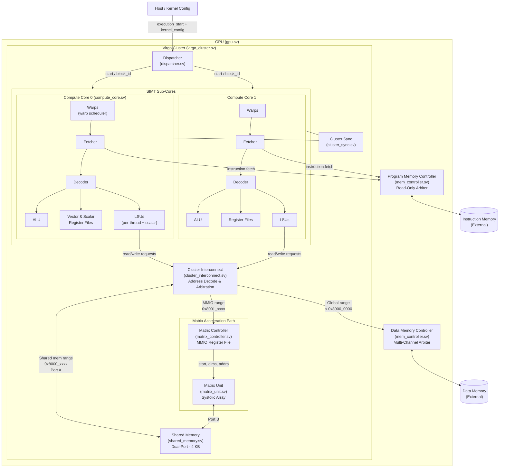

# mini-Virgo(Virgo Architecture)

An educational, system-verilog implementation of a parallel processor, modified to include the **Virgo micro-architecture** (a dedicated cluster-level matrix unit).

---

## Overview and GPU Architecture

`mini-Virgo` is a SystemVerilog RTL model of a simple RISC-V-like GPU. It explores modern GPU design concepts, specifically focusing on the integration of systolic arrays for matrix operations (GEMM).

### The Virgo Architecture



Traditional GPUs rely entirely on SIMT (Single Instruction, Multiple Thread) cores for computation. The **Virgo** architecture disaggregates this by introducing a dedicated **Matrix Unit** (a systolic array) at the cluster level.

*   **Cluster (SM) Level:** The GPU is divided into clusters. Each cluster contains multiple SIMD cores (`CORES_PER_CLUSTER`).
*   **Dedicated Matrix Unit:** A systolic array (`matrix_unit.sv`) is instantiated inside each cluster. It is designed specifically for matrix multiplication and accumulation (GEMM) workloads, offering better FLOPS scalability and energy efficiency.
*   **Shared Memory:** Each cluster features a local shared memory. This memory acts as a high-speed buffer accessible by both the SIMT cores and the matrix unit.
*   **Interconnect & Arbitration:** A cluster interconnect (`cluster_interconnect.sv`) arbitrates access to the shared memory and MMIO registers between the cores and the matrix unit.
*   **MMIO Control:** The SIMT cores control the matrix unit via Memory-Mapped I/O (MMIO) registers (e.g., `VIRGO_REG_CTRL`, `VIRGO_REG_ADDR_A`, `VIRGO_REG_DIM_M`). Threads configure the dimensions and memory addresses, and then write a start bit to trigger the GEMM operation.

### SIMT Cores
*   **Threads and Warps:** Threads are grouped into warps. All threads in a warp execute the same instruction in lockstep but on different data (using vector registers).
*   **Branching:** Handled via execution masking.
*   **Load-Store Unit (LSU):** Handles memory reads and writes, interacting with the cluster interconnect for shared/MMIO memory and the memory controller for global memory.

---

## Directory Structure

The repository is structured to separate the hardware description, simulation harness, and tests:

| Directory / File | Description |
| :--- | :--- |
| `src/` | Contains all the SystemVerilog hardware source code. |
| `src/gpu.sv` | The top-level GPU module integrating clusters, dispatcher, and memory controllers. |
| `src/virgo_cluster.sv` | The top-level module for a Virgo cluster, instantiating cores, shared memory, and the matrix unit. |
| `src/matrix_unit.sv` | The systolic array implementation for matrix operations. |
| `src/matrix_controller.sv`| Handles MMIO requests and controls the matrix unit. |
| `src/compute_core.sv` | The SIMT core implementation containing warps, ALUs, and LSUs. |
| `src/common/` | Shared definitions, constants, memory map addresses (`VIRGO_SHARED_MEM_BASE`, etc.), and typedefs. |
| `sim/` | The Verilator simulation environment. Contains C++ code to wrap the Verilog model and create a standalone `simulator` binary, as well as a simple assembler. |
| `test/` | C++ test suites (using Doctest). Contains unit tests and full-system tests. |
| `test/gpu/virgo_tests.cpp` | Tests specifically for the Virgo architecture, including shared memory, MMIO, and GEMM functional verification. |
| `external/` | External dependencies (like `doctest.h`). |

---

## Getting Started: How to Run

### Prerequisites
To build and simulate the GPU, you will need:
*   [Verilator](https://www.veripool.org/wiki/verilator) (translates SystemVerilog to C++)
*   [CMake](https://cmake.org/) (for building the project)
*   A C++23 compatible compiler (e.g., `g++-14` or `clang++`)

### 1. Build the Simulator and Tests
From the root of the repository, create a build directory and compile the project:

```bash
mkdir -p build && cd build
cmake ..
make -j$(sysctl -n hw.ncpu)
```
This will generate the `simulator` executable in `build/sim/` and the test executable in `build/test/gpu/`.

### 2. Run the Assembly Simulator
The simulator reads an assembly file, assembles it, and runs the RTL simulation.

```bash
cd /path/to/mini_virgo
./build/sim/simulator example.as
```
*(Note: If you have a custom assembly file for GEMM, like `example_gemm.as`, simply pass it as the argument instead).*

The output will trace the execution and eventually dump the contents of memory to the console, allowing you to verify the results of the computation.

### 3. Run the Test Suite
To verify the functionality of the hardware, run the automated test suite:

```bash
# Run all tests
./build/test/gpu/virgo_tests

# Run a specific Virgo test (e.g., the GEMM tile test)
./build/test/gpu/virgo_tests -tc="Virgo Architecture: Dedicated Cluster Matrix Unit GEMM Tile*"
```
The test suite compiles specific assembly programs on the fly, runs the simulation, and asserts that the final memory state matches the expected software-computed results.

---

## Roadmap & Extending
This is an educational platform. Future areas for expansion include:
*   Adding new RISC-V instructions to the decoder (`src/decoder.sv`).
*   Enhancing the systolic array (`src/matrix_unit.sv`) to support different data types or larger tile sizes.
*   Writing custom assembly programs to benchmark memory latency and matrix operation throughput.
