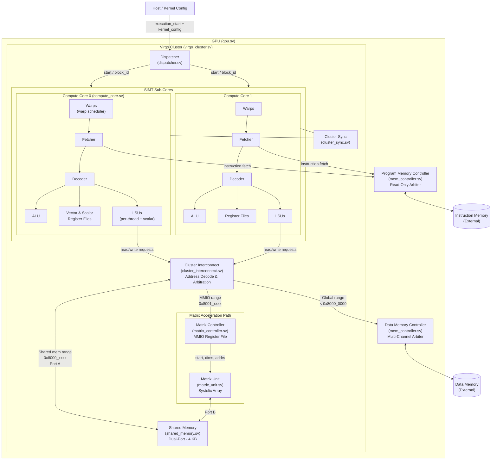
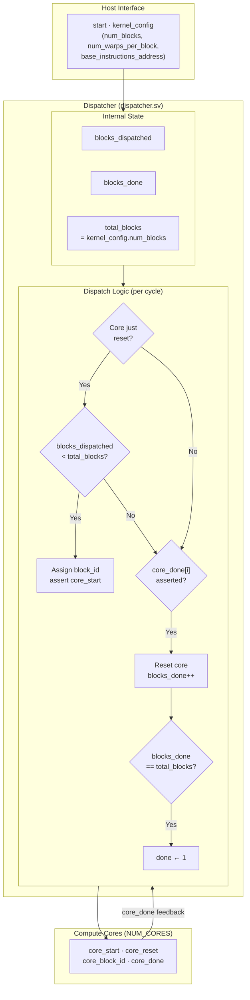
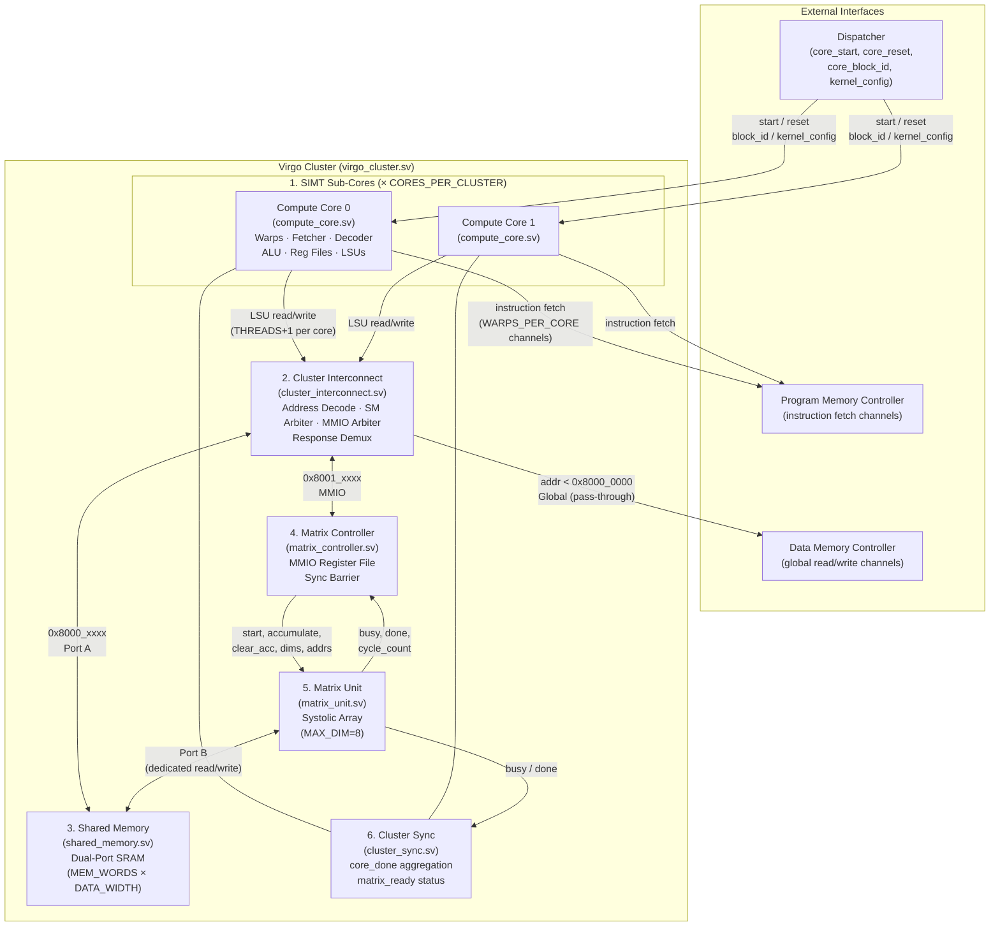
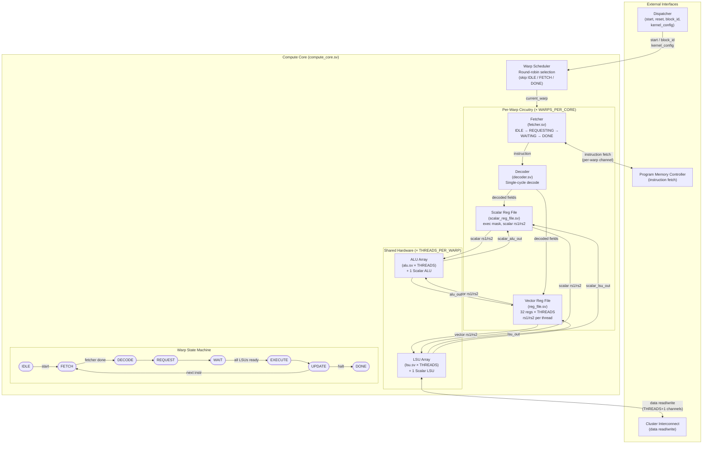
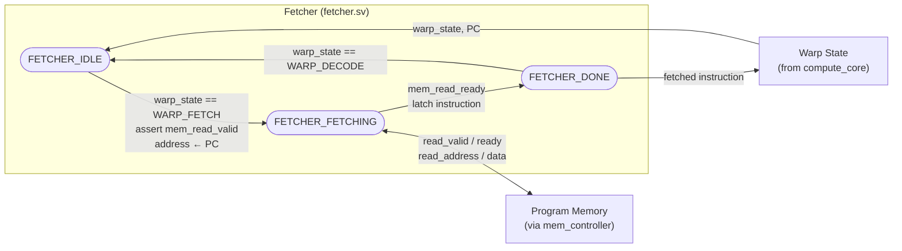
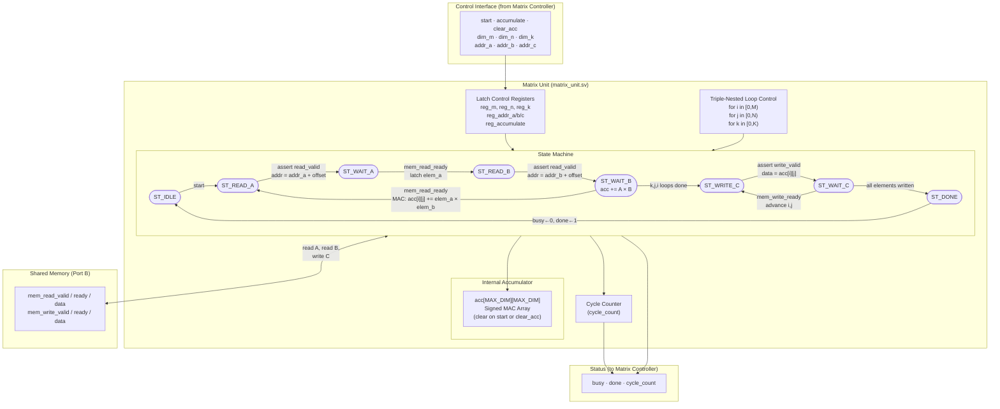
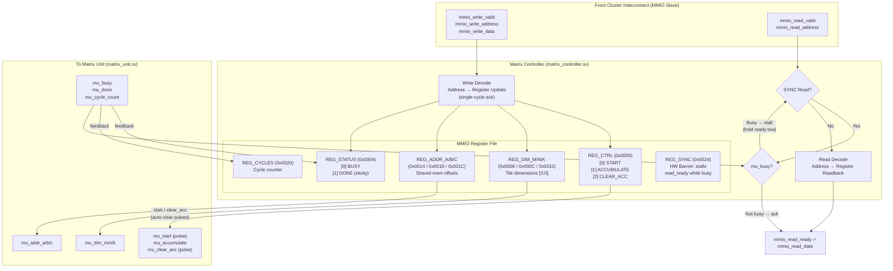
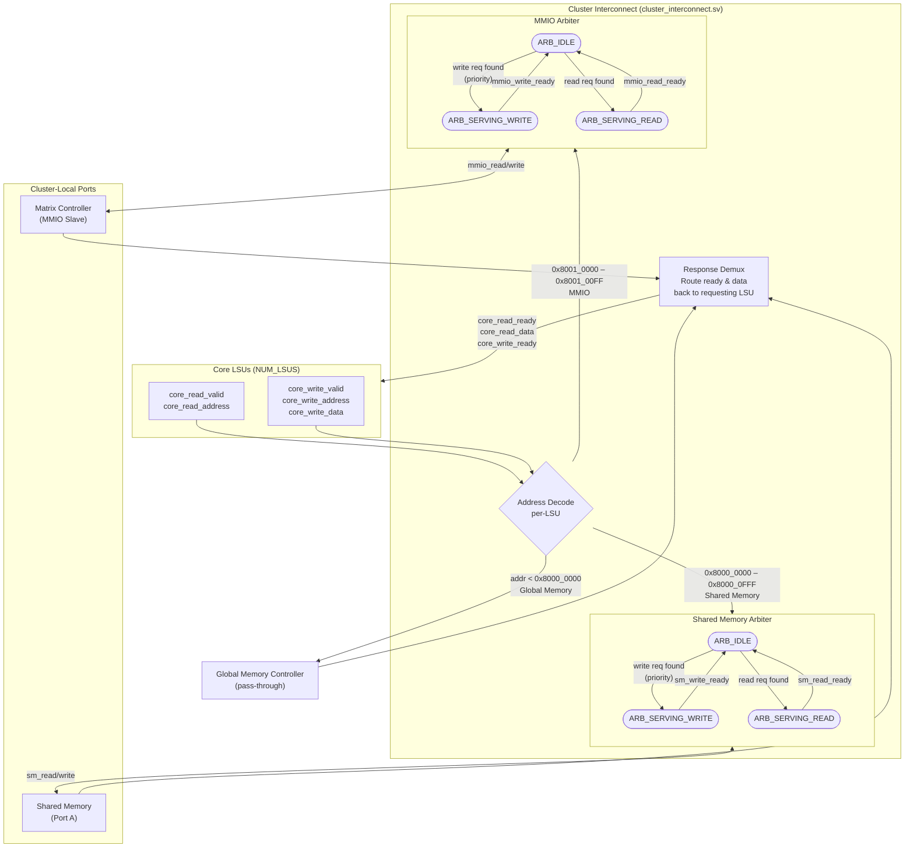
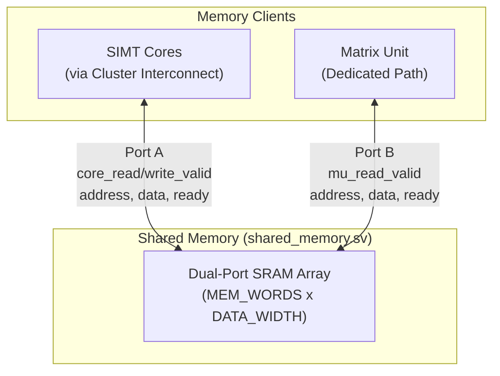
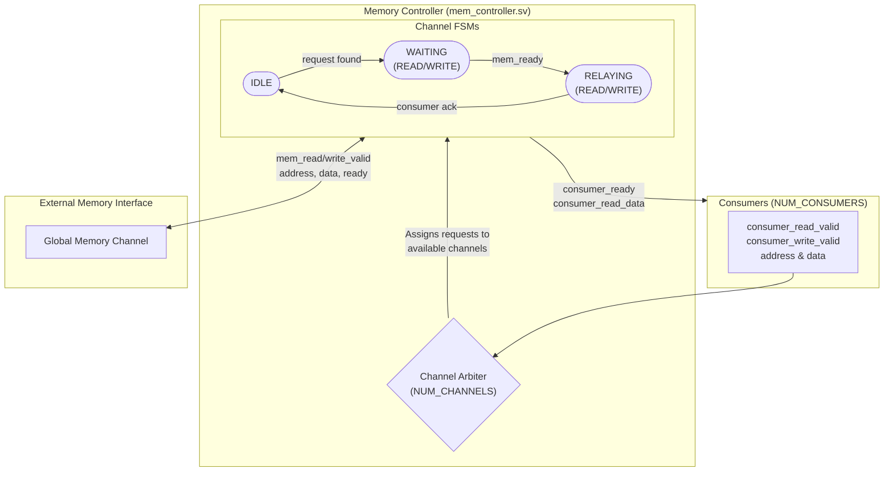

# mini-Virgo (Virgo Architecture)

An educational, SystemVerilog implementation of a parallel processor, modified to include the **Virgo micro-architecture** (a dedicated cluster-level matrix unit).

---

## Overview

`mini-Virgo` is a SystemVerilog RTL model of a simple RISC-V-like GPU. It explores modern GPU design concepts, specifically focusing on the integration of systolic arrays for matrix operations (GEMM).

Traditional GPUs rely entirely on SIMT (Single Instruction, Multiple Thread) cores for computation. The **Virgo** architecture disaggregates this by introducing a dedicated **Matrix Unit** (a systolic array) at the cluster level.

*   **Cluster (SM) Level:** The GPU is divided into clusters. Each cluster contains multiple SIMD cores (`CORES_PER_CLUSTER`).
*   **Dedicated Matrix Unit:** A systolic array (`matrix_unit.sv`) is instantiated inside each cluster. It is designed specifically for matrix multiplication and accumulation (GEMM) workloads, offering better FLOPS scalability and energy efficiency.
*   **Shared Memory:** Each cluster features a local shared memory. This memory acts as a high-speed buffer accessible by both the SIMT cores and the matrix unit.
*   **Interconnect & Arbitration:** A cluster interconnect (`cluster_interconnect.sv`) arbitrates access to the shared memory and MMIO registers between the cores and the matrix unit.
*   **MMIO Control:** The SIMT cores control the matrix unit via Memory-Mapped I/O (MMIO) registers (e.g., `VIRGO_REG_CTRL`, `VIRGO_REG_ADDR_A`, `VIRGO_REG_DIM_M`). Threads configure the dimensions and memory addresses, and then write a start bit to trigger the GEMM operation.

---

## Architecture

### Top-Level GPU



---

### Dispatcher



The Dispatcher (`dispatcher.sv`) is the GPU-level work scheduler that maps thread blocks from a kernel launch onto available hardware cores. On `start`, it resets all cores and begins dispatching — assigning a unique `block_id` to each free core and asserting `core_start`. When a core signals `core_done`, the dispatcher resets it and dispatches the next pending block (if any remain). Once `blocks_done == total_blocks`, the kernel is complete. Think of it as a work queue: if the kernel requires 10 blocks but only 2 cores exist, the dispatcher feeds blocks to cores as they become free, 2 at a time, until all 10 are done.

---

### Virgo Cluster



The Virgo Cluster (`virgo_cluster.sv`) is the top-level Streaming Multiprocessor (SM) equivalent in the Virgo architecture. Each cluster integrates six sub-blocks:

1.  **SIMT Sub-Cores** (`compute_core.sv` × `CORES_PER_CLUSTER`): Each core contains warp schedulers, instruction fetchers, decoders, ALUs, vector/scalar register files, and per-thread + scalar LSUs. Instruction fetch channels connect directly out to the Program Memory Controller; LSU traffic is routed through the cluster interconnect.
2.  **Cluster Interconnect** (`cluster_interconnect.sv`): Receives all LSU requests from every core and performs address-based routing — global memory requests (`< 0x8000_0000`) pass through to the external Data Memory Controller, shared memory accesses are arbitrated onto Port A, and MMIO accesses are arbitrated to the Matrix Controller.
3.  **Shared Memory** (`shared_memory.sv`): A dual-ported SRAM scratchpad. Port A serves the SIMT cores (via the interconnect arbiter); Port B provides a dedicated, contention-free path for the Matrix Unit to stream tile data.
4.  **Matrix Controller** (`matrix_controller.sv`): An MMIO slave that exposes configuration registers (tile dimensions, base addresses, control/status) to the cores. It also implements a hardware barrier (`REG_SYNC`) that stalls a reading thread until the Matrix Unit finishes.
5.  **Matrix Unit** (`matrix_unit.sv`): A systolic-array GEMM engine (configurable up to 8×8 tiles). It reads matrices A and B from shared memory via Port B, performs multiply-accumulate, and writes the result matrix C back.
6.  **Cluster Sync** (`cluster_sync.sv`): Aggregates `core_done` signals from all sub-cores and tracks the Matrix Unit's busy/done status, providing cluster-wide synchronization primitives.

---

### Compute Core (SIMT Core)



The Compute Core (`compute_core.sv`) is the SIMT execution engine. Each core contains:

*   **Warp Scheduler:** Round-robin selects the next warp that is ready to execute (skipping warps in `IDLE`, `FETCH`, or `DONE` states). The selected warp drives the shared ALU and LSU arrays.
*   **Per-Warp Circuitry** (replicated `WARPS_PER_CORE` times): A **Fetcher** that asynchronously requests instructions from program memory, a **Decoder** that produces control signals in one cycle, a **Scalar Register File** (holding execution masks and scalar operands), and a **Vector Register File** (32 registers × `THREADS_PER_WARP`, providing per-thread `rs1`/`rs2`).
*   **Shared Hardware** (replicated `THREADS_PER_WARP` times): An **ALU** and **LSU** per thread, plus one scalar ALU and one scalar LSU. These are time-multiplexed across warps by the scheduler.
*   **Warp State FSM:** Each warp independently cycles through `FETCH → DECODE → REQUEST → WAIT → EXECUTE → UPDATE`, then either loops back to `FETCH` or transitions to `DONE` on a halt instruction. Execution masking handles divergent branches.
*   **Latency Hiding:** Although only one warp occupies the ALU/LSU hardware per cycle, all warps progress concurrently — fetchers run in parallel, so while one warp executes, others can be fetching or waiting on memory. The scheduler switches to a ready warp whenever the current one finishes its `UPDATE` stage.

---

### Fetcher



The Fetcher (`fetcher.sv`) is a lightweight 3-state FSM that retrieves a single instruction from program memory for its warp. In `IDLE`, it waits until the warp enters `WARP_FETCH`, then asserts `mem_read_valid` with the current PC. In `FETCHING`, it waits for the program memory controller to respond with `mem_read_ready` and latches the instruction data. In `DONE`, it holds the instruction until the warp advances to `WARP_DECODE`, then returns to idle. Each warp has its own dedicated fetcher instance, enabling multiple warps to fetch instructions in parallel — this is the foundation of the core's latency-hiding mechanism.

---

### Matrix Unit



The Matrix Unit (`matrix_unit.sv`) is a systolic-array-based compute engine dedicated to General Matrix Multiply-Accumulate (GEMM). It reads tile data (matrices A and B) from shared memory via Port B, performs the multiply-accumulate through a configurable M×N×K pipeline, and writes the result (matrix C) back. An internal accumulator can be preserved across invocations (`accumulate` mode) or cleared (`clear_acc`), enabling tiled outer-product loops. A cycle counter tracks operation latency.

---

### Matrix Controller



The Matrix Controller (`matrix_controller.sv`) is an MMIO slave that exposes the matrix unit's configuration as a set of memory-mapped registers in the `0x8001_0000` address range. SIMT cores write tile dimensions (`DIM_M/N/K`), shared-memory base addresses (`ADDR_A/B/C`), and control bits (`START`, `ACCUMULATE`, `CLEAR_ACC`) through ordinary store instructions. Reads to `REG_STATUS` return the busy/done state. A special `REG_SYNC` register acts as a hardware barrier — the controller holds `read_ready` low while the matrix unit is busy, effectively stalling the requesting thread until the GEMM operation completes.

---

### Cluster Interconnect



The Cluster Interconnect (`cluster_interconnect.sv`) demultiplexes memory requests from all core LSUs based on address:

*   **Global Memory** (`< 0x8000_0000`): passed through directly — each LSU has its own external channel, so no arbitration is needed.
*   **Shared Memory** (`0x8000_0000 – 0x8000_0FFF`) and **MMIO** (`0x8001_0000 – 0x8001_00FF`): both are single-ported resources, so concurrent access from multiple LSUs must be serialized.

Each resource has a **fixed-priority arbiter** — a 3-state FSM (`IDLE → SERVING_READ / SERVING_WRITE → IDLE`). In `IDLE`, the arbiter scans LSUs starting from index 0; the first LSU with a matching request wins. Writes are checked before reads, giving store operations priority. Once granted, the arbiter stays in the serving state until the destination asserts `ready`, then returns to `IDLE`.

The **response demux** routes `ready` and `data` signals back to the specific LSU that won arbitration. Only the winning LSU's `core_read_ready` / `core_write_ready` is asserted; all others see `0` (stalled) until the current transaction completes.

---

### Shared Memory



The Shared Memory (`shared_memory.sv`) provides a high-throughput, low-latency dual-ported scratchpad memory local to each cluster. Port A is mapped to the cluster interconnect and serves read and write requests from the SIMT cores. Port B provides a dedicated read-only path directly to the Matrix Unit, ensuring that matrix data tiles can be streamed into the systolic array without interfering with core memory operations or arbitration bottlenecks.

---

### Memory Controller



The Memory Controller (`mem_controller.sv`) manages concurrent accesses to global memory (both instruction and data memory) from numerous consumers (Fetchers or LSUs). It instantiates multiple memory channels (`NUM_CHANNELS`) and tracks their state using independent FSMs. When a channel is idle, it scans the consumers to find a pending read or write request, locks onto it, and dispatches it to the external memory interface. Once the memory responds, the channel relays the data or acknowledgment back to the specific consumer and waits for a consumer acknowledgment before returning to the idle state.

---

## Default Hardware Resource Summary

The table below shows the concrete resource counts using the default parameters from `gpu.sv`. All parameters are configurable at synthesis time.

| Level | Resource | Count | Notes |
| :--- | :--- | :--- | :--- |
| **GPU** | Clusters | **1** | `NUM_CLUSTERS = 1` |
| | Data Memory Channels | 8 | `DATA_MEM_NUM_CHANNELS = 8` |
| | Instruction Memory Channels | 8 | `INSTRUCTION_MEM_NUM_CHANNELS = 8` |
| **Per Cluster** | Compute Cores | **2** | `CORES_PER_CLUSTER = 2` |
| | Matrix Unit | 1 | Systolic array, up to 8×8 tiles |
| | Shared Memory | 1 | 1024 words = 4 KB |
| | Cluster Interconnect | 1 | Address decode + arbitration |
| **Per Core** | Warps | **2** | `WARPS_PER_CORE = 2` |
| | Threads per Warp | **32** | `THREADS_PER_WARP = 32` |
| | ALUs (shared) | **33** | 32 per-thread + 1 scalar, time-multiplexed across warps |
| | LSUs (shared) | **33** | 32 per-thread + 1 scalar, time-multiplexed across warps |
| | Vector Register Files | **2** | 1 per warp (32 regs × 32 threads each) |
| | Scalar Register Files | **2** | 1 per warp (exec mask + scalar operands) |
| | Fetchers | **2** | 1 per warp (fetch in parallel) |
| | Decoders | **2** | 1 per warp |
| **GPU Totals** | Cores | 2 | 1 cluster × 2 cores |
| | Warps | 4 | 2 cores × 2 warps |
| | Threads | 128 | 4 warps × 32 threads |
| | ALUs | 66 | 2 cores × 33 ALUs |
| | LSUs | 66 | 2 cores × 33 LSUs |

---

## Directory Structure

The repository is structured to separate the hardware description, simulation harness, and tests:

| Directory / File | Description |
| :--- | :--- |
| `src/` | Contains all the SystemVerilog hardware source code. |
| `src/gpu.sv` | The top-level GPU module integrating clusters, dispatcher, and memory controllers. |
| `src/virgo_cluster.sv` | The top-level module for a Virgo cluster, instantiating cores, shared memory, and the matrix unit. |
| `src/matrix_unit.sv` | The systolic array implementation for matrix operations. |
| `src/matrix_controller.sv`| Handles MMIO requests and controls the matrix unit. |
| `src/compute_core.sv` | The SIMT core implementation containing warps, ALUs, and LSUs. |
| `src/common/` | Shared definitions, constants, memory map addresses (`VIRGO_SHARED_MEM_BASE`, etc.), and typedefs. |
| `sim/` | The Verilator simulation environment. Contains C++ code to wrap the Verilog model and create a standalone `simulator` binary, as well as a simple assembler. |
| `test/` | C++ test suites (using Doctest). Contains unit tests and full-system tests. |
| `test/gpu/virgo_tests.cpp` | Tests specifically for the Virgo architecture, including shared memory, MMIO, and GEMM functional verification. |
| `external/` | External dependencies (like `doctest.h`). |

---

## Getting Started: How to Run

### Prerequisites
To build and simulate the GPU, you will need:
*   [Verilator](https://www.veripool.org/wiki/verilator) (translates SystemVerilog to C++)
*   [CMake](https://cmake.org/) (for building the project)
*   A C++23 compatible compiler (e.g., `g++-14` or `clang++`)

### 1. Build the Simulator and Tests
From the root of the repository, create a build directory and compile the project:

```bash
mkdir -p build && cd build
cmake ..
make -j$(sysctl -n hw.ncpu)
```
This will generate the `simulator` executable in `build/sim/` and the test executable in `build/test/gpu/`.

### 2. Run the Assembly Simulator
The simulator reads an assembly file, assembles it, and runs the RTL simulation.

```bash
cd /path/to/mini_virgo
./build/sim/simulator example.as
```
*(Note: If you have a custom assembly file for GEMM, like `example_gemm.as`, simply pass it as the argument instead).*

The output will trace the execution and eventually dump the contents of memory to the console, allowing you to verify the results of the computation.

### 3. Run the Test Suite
To verify the functionality of the hardware, run the automated test suite:

```bash
# Run all tests
./build/test/gpu/virgo_tests

# Run a specific Virgo test (e.g., the GEMM tile test)
./build/test/gpu/virgo_tests -tc="Virgo Architecture: Dedicated Cluster Matrix Unit GEMM Tile*"
```
The test suite compiles specific assembly programs on the fly, runs the simulation, and asserts that the final memory state matches the expected software-computed results.

---

## Roadmap & Extending
This is an educational platform. Future areas for expansion include:
*   Adding new RISC-V instructions to the decoder (`src/decoder.sv`).
*   Enhancing the systolic array (`src/matrix_unit.sv`) to support different data types or larger tile sizes.
*   Writing custom assembly programs to benchmark memory latency and matrix operation throughput.
