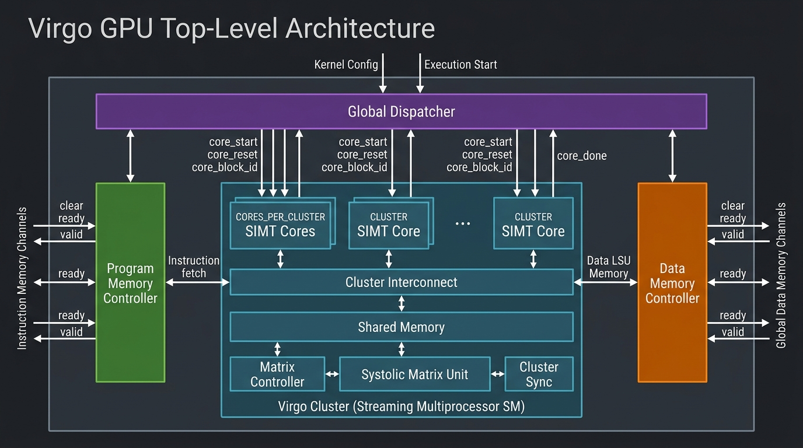
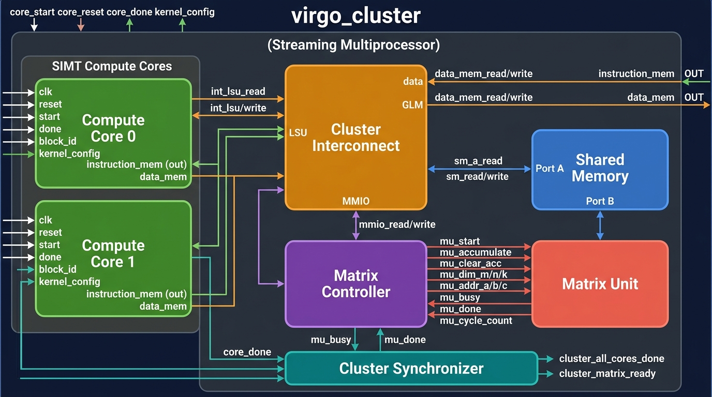
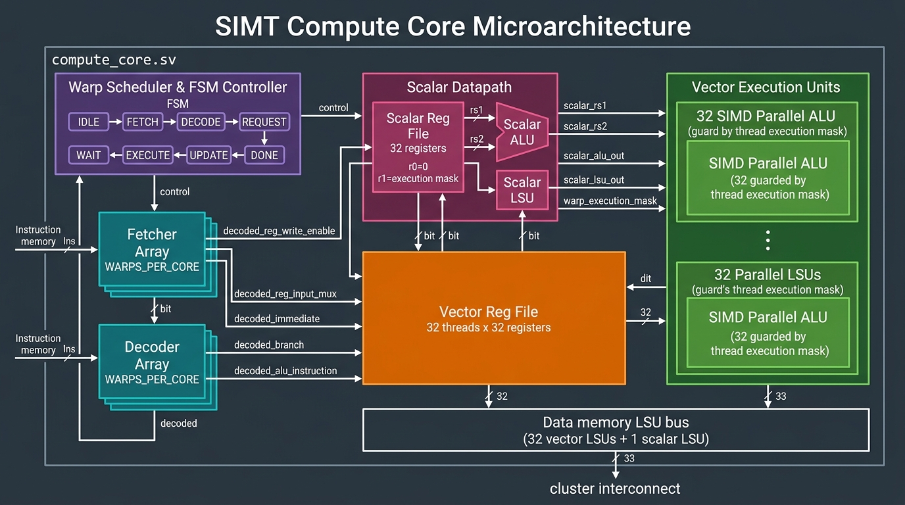
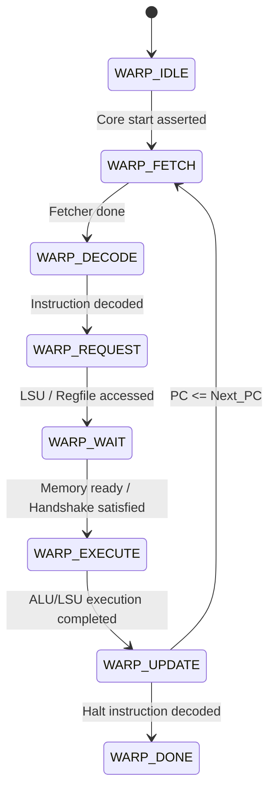
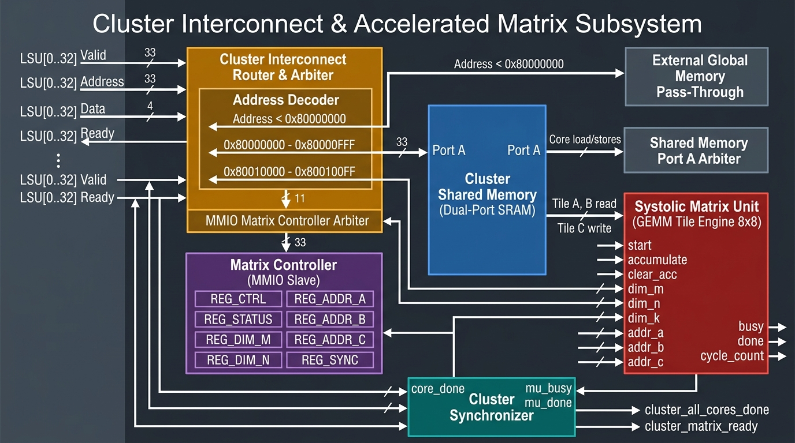

# Mini-Virgo GPU Architecture & Microarchitecture Specification

This document provides a comprehensive technical reference for the **Mini-Virgo GPU**, detailing the top-level GPU hierarchy, the Virgo Cluster (Streaming Multiprocessor), the SIMT Compute Cores, the Cluster Interconnect and Memory subsystem, the Accelerated Matrix Subsystem, and all associated control signals and interfaces.

---

## Table of Contents
1. [Overall GPU Architecture](#1-overall-gpu-architecture)
2. [Top-Level Control Signals & Memory Interfaces](#2-top-level-control-signals--memory-interfaces)
3. [Virgo Cluster (Streaming Multiprocessor)](#3-virgo-cluster-streaming-multiprocessor)
4. [SIMT Compute Core Deep-Dive](#4-simt-compute-core-deep-dive)
5. [Cluster Interconnect & Memory Subsystem](#5-cluster-interconnect--memory-subsystem)
6. [Accelerated Matrix Subsystem (Controller & Unit)](#6-accelerated-matrix-subsystem-controller--unit)
7. [Cluster Synchronizer & Global Dispatcher](#7-cluster-synchronizer--global-dispatcher)
8. [Summary of Memory Map & MMIO Address Space](#8-summary-of-memory-map--mmio-address-space)

---

## 1. Overall GPU Architecture

The Mini-Virgo GPU is a SIMT (Single Instruction, Multiple Threads) processor designed for high-throughput parallel compute and matrix-accelerated workloads (such as GEMM for deep learning).

### Architecture Diagram


### Top-Level Composition
The top-level entity is instantiated in [`gpu.sv`](file:///Users/alexa/Desktop/mini_virgo/src/gpu.sv) and comprises:
- **Global Dispatcher (`dispatcher.sv`)**: Distributes thread blocks from the launch kernel across available cores, managing per-core resets, start pulses, and global execution completion.
- **Program Memory Controller (`mem_controller.sv`)**: Multi-channel arbiter/router serving instruction fetch requests from all warp fetchers across all clusters to external instruction memory.
- **Data Memory Controller (`mem_controller.sv`)**: Multi-channel arbiter serving external global memory read/write requests issued by the load-store units (LSUs).
- **Virgo Clusters (`virgo_cluster.sv`)**: Scalable Streaming Multiprocessors (SMs), each containing multiple SIMT compute cores, a shared interconnect, a dual-ported cluster shared memory, an MMIO matrix controller, a systolic matrix engine, and a cluster synchronizer.

---

## 2. Top-Level Control Signals & Memory Interfaces

### Top-Level Port List (`gpu.sv`)

| Port Name | Direction | Width / Type | Description |
|:---|:---:|:---|:---|
| `clk` | Input | `1` | Master clock signal |
| `reset` | Input | `1` | Asynchronous/synchronous system reset |
| `execution_start` | Input | `1` | Pulse to start executing a loaded kernel |
| `execution_done` | Output | `1` | Asserted high when all dispatched blocks are complete |
| `kernel_config` | Input | `kernel_config_t` | Base code/data addresses, block count, warps per block |
| `instruction_mem_read_valid` | Output | `[INSTRUCTION_MEM_NUM_CHANNELS-1:0]` | Valid request to external instruction memory |
| `instruction_mem_read_address`| Output | `[INSTRUCTION_MEM_NUM_CHANNELS]` | Instruction memory addresses requested |
| `instruction_mem_read_ready` | Input | `[INSTRUCTION_MEM_NUM_CHANNELS-1:0]` | Ready handshake from instruction memory |
| `instruction_mem_read_data` | Input | `[INSTRUCTION_MEM_NUM_CHANNELS]` | Returned 32-bit instruction words |
| `data_mem_read_valid` | Output | `[DATA_MEM_NUM_CHANNELS-1:0]` | Read request valid to global memory |
| `data_mem_read_address` | Output | `[DATA_MEM_NUM_CHANNELS]` | Read byte/word address to global memory |
| `data_mem_read_ready` | Input | `[DATA_MEM_NUM_CHANNELS-1:0]` | Ready acknowledge from global memory controller |
| `data_mem_read_data` | Input | `[DATA_MEM_NUM_CHANNELS]` | Returned data from global memory |
| `data_mem_write_valid` | Output | `[DATA_MEM_NUM_CHANNELS-1:0]` | Write request valid to global memory |
| `data_mem_write_address` | Output | `[DATA_MEM_NUM_CHANNELS]` | Destination write address |
| `data_mem_write_data` | Output | `[DATA_MEM_NUM_CHANNELS]` | Data payload to write |
| `data_mem_write_ready` | Input | `[DATA_MEM_NUM_CHANNELS-1:0]` | Write completion / acknowledge |

---

## 3. Virgo Cluster (Streaming Multiprocessor)

The **Virgo Cluster** ([`virgo_cluster.sv`](file:///Users/alexa/Desktop/mini_virgo/src/virgo_cluster.sv)) abstracts an autonomous compute cluster.

### Cluster Block Diagram


### Internal Modules & Roles
1. **Compute Cores (`compute_core.sv`)**: `CORES_PER_CLUSTER` instances. Each core runs warps with SIMT execution.
2. **Cluster Interconnect (`cluster_interconnect.sv`)**: Demultiplexes core LSU memory requests into Global Memory, Local Shared Memory, or MMIO registers.
3. **Shared Memory (`shared_memory.sv`)**: Dual-port banked SRAM. Port A is shared by the cores; Port B provides direct tile read/write access to the Systolic Matrix Unit.
4. **Matrix Controller (`matrix_controller.sv`)**: MMIO slave register file for non-blocking dispatch and monitoring of GEMM tasks.
5. **Matrix Unit (`matrix_unit.sv`)**: Systolic GEMM engine executing $C = A \times B + C$ directly against Shared Memory.
6. **Cluster Synchronizer (`cluster_sync.sv`)**: Aggregates core completion and matrix engine state to coordinate cluster-level barriers.

---

## 4. SIMT Compute Core Deep-Dive

Each compute core ([`compute_core.sv`](file:///Users/alexa/Desktop/mini_virgo/src/compute_core.sv)) executes warps concurrently using fine-grained warp scheduling.

### Compute Core Microarchitecture Diagram


### 4.1. Warp State Machine (FSM)
Each warp independently transitions through the following 8 states:


- **`WARP_IDLE`**: Warp inactive until block dispatch.
- **`WARP_FETCH`**: Fetcher issues instruction memory request.
- **`WARP_DECODE`**: Instruction fields parsed into register indices, immediates, ALU opcodes, and control masks.
- **`WARP_REQUEST`**: Operands read from scalar/vector register files; load/store requests placed on the memory buses.
- **`WARP_WAIT`**: Pauses until all active thread LSUs and scalar LSUs receive memory acknowledges.
- **`WARP_EXECUTE`**: ALUs calculate arithmetic/logic results; branch evaluation determines `next_pc`.
- **`WARP_UPDATE`**: Writeback results written to register files; PC updated. If `decoded_halt` is set, warp transitions to `WARP_DONE`.
- **`WARP_DONE`**: Warp execution terminated. When all warps reach `WARP_DONE`, the core asserts `done`.

### 4.2. Scalar Datapath vs. Vector Datapath
- **Scalar Register File (`scalar_reg_file.sv`)**:
  - 32 scalar registers per warp.
  - `registers[0]` is hardwired to 0.
  - `registers[1]` holds the **Warp Execution Mask** (controls active SIMT lanes).
  - Handles uniform loop variables, branch targets, and pointer math.
  - Supports 5 write sources via `decoded_reg_input_mux`: `ALU_OUT`, `LSU_OUT`, `IMMEDIATE`, `PC_PLUS_1`, and `VECTOR_TO_SCALAR`.
- **Vector Register File (`reg_file.sv`)**:
  - Contains $32 \times 32$ registers (32 threads $\times$ 32 registers).
  - Operates under the mask supplied by `warp_execution_mask`.
- **Execution Units**:
  - 1 Scalar ALU & 1 Scalar LSU per warp.
  - 32 Parallel Vector ALUs & 32 Parallel Vector LSUs per core.

### 4.3. Compute Core Control Signals

| Signal Name | Width | Direction | Functional Description |
|:---|:---:|:---:|:---|
| `start` | 1 | Input | Starts block execution on this core |
| `done` | 1 | Output | Indicates all warps in the core have completed |
| `block_id` | 32 | Input | Dispatched thread block identifier |
| `decoded_reg_write_enable` | `[WARPS_PER_CORE]` | Internal | Enables destination register writeback |
| `decoded_reg_input_mux` | enum | Internal | Selects source: ALU, LSU, Immediate, PC+1, Vector->Scalar |
| `decoded_scalar_instruction`| `[WARPS_PER_CORE]` | Internal | Routes instruction to scalar vs. vector datapath |
| `decoded_branch` | `[WARPS_PER_CORE]` | Internal | Flags conditional branch evaluation |
| `decoded_alu_instruction` | `[4:0]` | Internal | ALU opcode (ADD, SUB, AND, OR, SLL, SLT, etc.) |
| `decoded_halt` | `[WARPS_PER_CORE]` | Internal | Flags end of warp execution |
| `warp_execution_mask` | `[31:0]` | Internal | Active lane predicate mask from scalar reg 1 |

---

## 5. Cluster Interconnect & Memory Subsystem

The cluster interconnect ([`cluster_interconnect.sv`](file:///Users/alexa/Desktop/mini_virgo/src/cluster_interconnect.sv)) routes and arbitrates requests from `TOTAL_LSUS` ($33 \text{ per core} = 32 \text{ vector} + 1 \text{ scalar}$).

### Interconnect & Accelerated Memory Schematic


### 5.1. Address Decoding Logic
Addresses are categorized into three physical zones:
1. **Global Memory (`addr < 0x8000_0000`)**:
   - Passed directly to `ext_read_*` and `ext_write_*` connected to the top-level Data Memory Controller.
2. **Local Cluster Shared Memory (`0x8000_0000 <= addr < 0x8000_0FFF`)**:
   - Routed to the Shared Memory Arbiter serving Port A.
3. **MMIO Matrix Controller (`0x8001_0000 <= addr < 0x8001_00FF`)**:
   - Routed to the MMIO Arbiter driving Matrix Controller registers.

### 5.2. Arbitration State Machine
Both Shared Memory Port A and MMIO utilize an identical arbitration state machine:
- **`ARB_IDLE`**: Scans requests across all LSUs (writes take precedence over reads to protect store visibility). Locks in `sm_consumer` or `mmio_consumer`.
- **`ARB_SERVING_READ`**: Holds bus valid until slave asserts `ready`.
- **`ARB_SERVING_WRITE`**: Holds bus valid and payload until slave asserts `ready`.
- **Response Demultiplexing**: Ready and read data are routed back exclusively to the requesting consumer LSU.

---

## 6. Accelerated Matrix Subsystem (Controller & Unit)

To prevent matrix multiplication workloads from saturating the SIMT register file and execution pipelines, Virgo disaggregates matrix math into a cluster-level systolic engine.

### 6.1. MMIO Matrix Controller Register Map (`matrix_controller.sv`)

| Offset / Name | Address | Access | Description |
|:---|:---:|:---:|:---|
| `VIRGO_REG_CTRL` | `0x8001_0000` | R/W | Bit 0: `busy`, Bit 1: `accumulate`, Bit 2: `clear_acc`, Write 1: `start` pulse |
| `VIRGO_REG_STATUS` | `0x8001_0004` | R | Bit 0: `done_sticky`, Bit 1: `busy` |
| `VIRGO_REG_DIM_M` | `0x8001_0008` | R/W | Number of rows of matrix A and C (max 8) |
| `VIRGO_REG_DIM_N` | `0x8001_000C` | R/W | Number of columns of matrix B and C (max 8) |
| `VIRGO_REG_DIM_K` | `0x8001_0010` | R/W | Inner dimension (cols of A, rows of B) |
| `VIRGO_REG_ADDR_A` | `0x8001_0014` | R/W | Shared Memory base byte address for Matrix A |
| `VIRGO_REG_ADDR_B` | `0x8001_0018` | R/W | Shared Memory base byte address for Matrix B |
| `VIRGO_REG_ADDR_C` | `0x8001_001C` | R/W | Shared Memory base byte address for Matrix C |
| `VIRGO_REG_CYCLE_CNT`| `0x8001_0020` | R | Matrix unit elapsed cycle counter |
| `VIRGO_REG_SYNC` | `0x8001_0024` | R | Hardware barrier: stalls read until `mu_busy == 0` |

### 6.2. Systolic Matrix Unit (`matrix_unit.sv`)
- **Direct SRAM Access**: Operates over **Port B** of `shared_memory.sv`, allowing memory transfers without SIMT core register file spilling.
- **FSM Operation**:
  - `ST_IDLE`: Waits for `mu_start`.
  - `ST_READ_A` / `ST_WAIT_A`: Reads Tile A elements into internal operand buffers.
  - `ST_READ_B` / `ST_WAIT_B`: Reads Tile B elements into internal operand buffers.
  - Compute & Accumulate: Multiplies $A_{ik} \times B_{kj}$ and accumulates into `acc[MAX_DIM][MAX_DIM]`.
  - `ST_WRITE_C` / `ST_WAIT_C`: Streams accumulated results back into shared memory.
  - `ST_DONE`: Asserts single-cycle `mu_done` and sets `reg_done_sticky`.

---

## 7. Cluster Synchronizer & Global Dispatcher

### 7.1. Cluster Synchronizer (`cluster_sync.sv`)
Synchronizes execution across cores and between the SIMT pipeline and the Matrix Unit:
- `cluster_all_cores_done = &core_done`: True when all compute cores in the cluster have finished their blocks.
- `cluster_matrix_ready = !mu_busy`: True when the matrix engine is idle and ready for a new operation.

### 7.2. Global Dispatcher (`dispatcher.sv`)
- **Block Allocation**: Tracks `blocks_dispatched` against `kernel_config.num_blocks`.
- **Dynamic Core Re-assignment**: When a core finishes (`core_done` asserted), the dispatcher pulses `core_reset`, increments `blocks_done`, assigns a new `core_block_id`, and pulses `core_start`.
- **Completion Detection**: When `blocks_done == total_blocks`, asserts global `execution_done`.

---

## 8. Summary of Memory Map & MMIO Address Space

```
+-----------------------------------+ 0xFFFF_FFFF
|                                   |
|   Reserved / High Memory Space    |
|                                   |
+-----------------------------------+ 0x8001_0100
|   Matrix Controller MMIO Space    | (256 B: Ctrl, Dims, Addrs, Sync)
+-----------------------------------+ 0x8001_0000
|   Reserved Space                  |
+-----------------------------------+ 0x8000_1000
|   Cluster Shared Memory Space     | (4 KB: Scratchpad & Matrix Tiles)
+-----------------------------------+ 0x8000_0000
|                                   |
|   Global Data Memory Space        | (DRAM / Host mapped data)
|                                   |
+-----------------------------------+ 0x0000_0000
```
